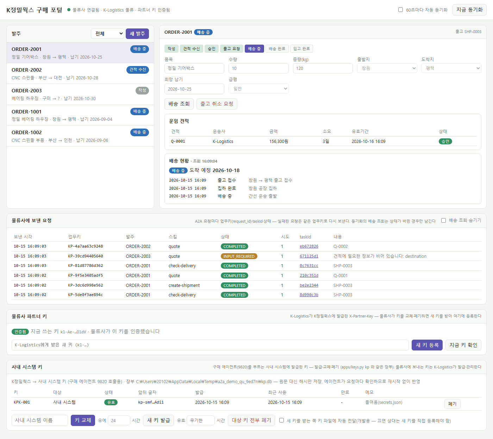
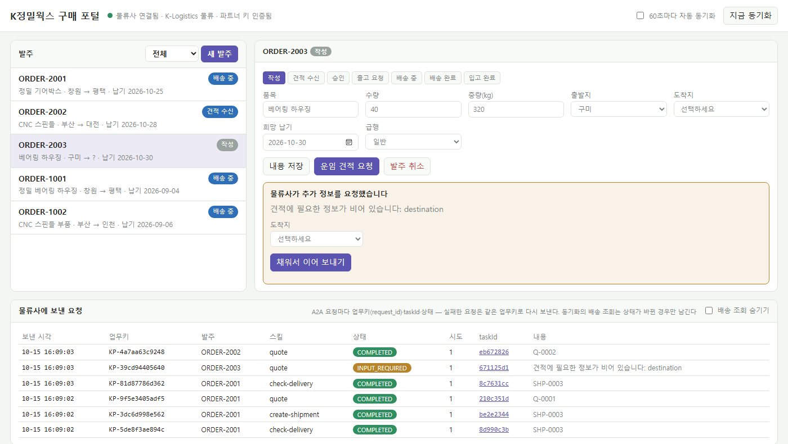
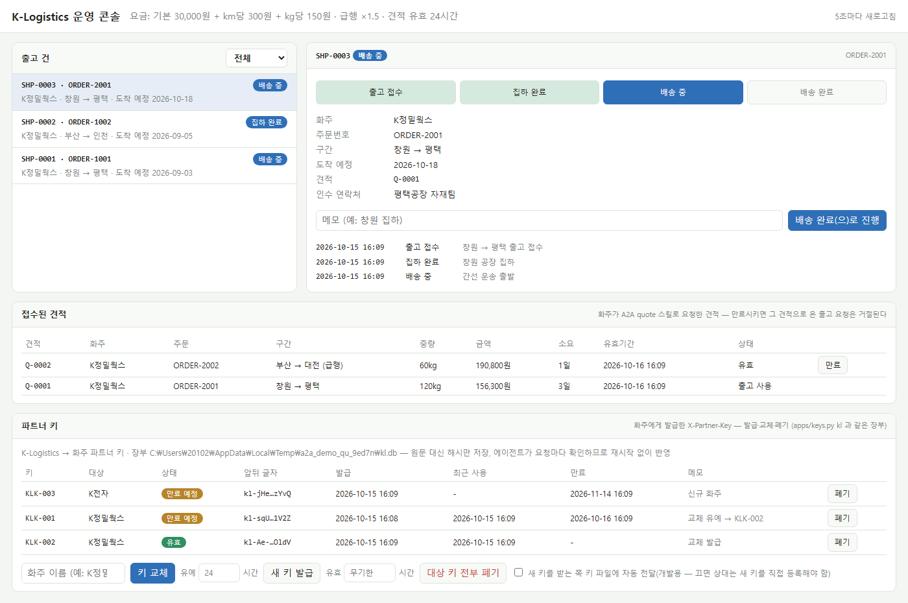
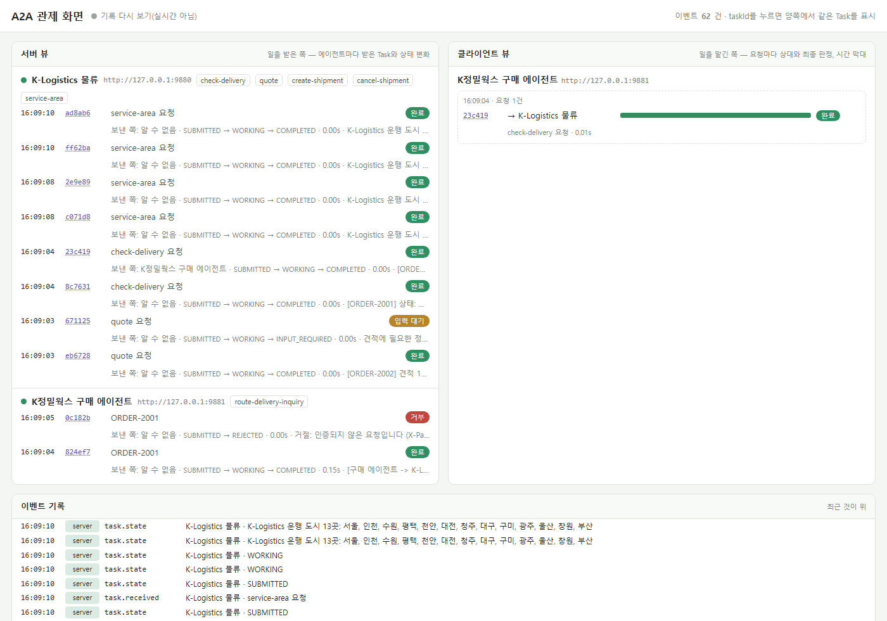
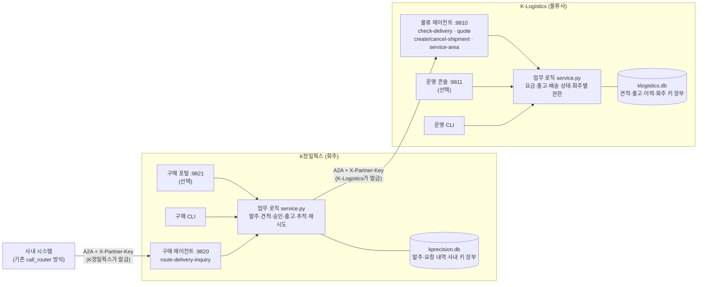
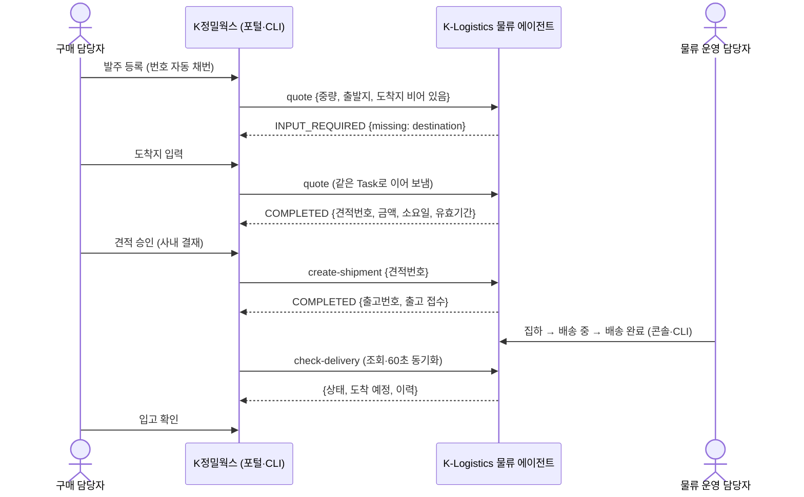

# A2A 회사 간 업무 시스템 — K정밀웍스 ↔ K-Logistics

부품 제조사 **K정밀웍스**(화주)와 물류사 **K-Logistics**가 **A2A 프로토콜로만** 업무를 주고받는 예제 시스템입니다.
발주 → 운임 견적 → 승인 → 출고 → 배송 추적 → 입고까지 실제 업무 흐름을 따라가고, 회사 간 호출에는 파트너 API Key 인증과 화주별 권한 확인이 들어갑니다.

「A2A 프로토콜 실전 가이드」 Part 3(Ch13~17: 에이전트 탐색·위임·실패와 재시도·구조화 데이터·병렬 오케스트레이션)와 Part 4 Ch18(인증)의 실습 코드를, 1회성 예제가 아니라 **매일 쓰는 업무 시스템** 형태로 옮긴 것입니다.

- **회사마다 독립된 시스템**: 각자 업무 로직과 DB(SQLite)를 가지고, 상대 DB는 보지 않습니다. 회사 사이는 A2A 에이전트로만 오갑니다.
- **웹 화면 없이도 연동**: 웹 화면과 명령줄 도구가 같은 업무 함수를 부릅니다. 화면을 꺼도 회사 간 연동은 그대로 동작합니다.
- **구조화된 계약**: 스킬마다 JSON 계약(pydantic)으로 검증하고, 업무키(`request_id`)로 재시도해도 중복 처리되지 않습니다.
- **인증과 키 관리**: `X-Partner-Key` 헤더 인증, 키 장부(해시 저장), 교체(유예기간)·폐기가 서버 재시작 없이 바로 반영됩니다.
- **자동 검증**: 시나리오 21개를 웹 화면·관제 허브 없이 돌려 판정합니다.

---

## 화면

### K정밀웍스 구매 포털 (`:9821`)
발주 목록과 상세(진행 단계, 운임 견적, 배송 이력), 물류사에 보낸 A2A 요청 내역(업무키·taskId·상태), 물류사 파트너 키 상태와 사내 시스템 키 관리.



물류사가 견적에 필요한 정보가 없다고 되물으면(A2A `INPUT_REQUIRED`) 입력 폼이 뜨고, 채워서 **같은 Task로** 이어 보냅니다. 출발지·도착지 콤보박스는 물류사가 알려 준 운행 도시(`service-area` 스킬)로 채워집니다.



### K-Logistics 운영 콘솔 (`:9811`)
출고 건 목록과 상세(상태 진행·메모·이력), 화주가 요청한 견적, 화주에게 발급한 파트너 키(발급·교체·폐기, 최근 사용 시각).



### A2A 관제 화면 (선택, `:9900`)
에이전트가 받은 Task와 상태 변화(서버 뷰), 맡긴 쪽의 요청(클라이언트 뷰). 인증 없이 들어온 요청이 `거부`로 보입니다. 관제 허브는 원본 실습 폴더의 `obs/`를 씁니다(이 저장소에는 포함하지 않음).



---

## 구조



- 각 회사의 **에이전트**만 있으면 회사 간 연동이 됩니다. 웹 화면과 CLI는 사람이 업무를 하는 수단입니다.
- 키는 **발급한 회사가 관리**합니다. K-Logistics는 화주에게 준 키를, K정밀웍스는 사내 시스템에 준 키를 자기 DB의 장부에 둡니다.

## 업무 흐름 (핵심 시나리오)



모든 화살표(K정밀웍스 → K-Logistics)에는 `X-Partner-Key` 헤더가 붙고, 물류사는 키로 화주를 확인한 뒤 **그 화주의 출고 건·견적만** 다룹니다.

## 검증된 시나리오

`uv run apps\scenarios\run_all.py` 가 에이전트를 임시 포트·임시 DB로 직접 띄워 아래 21개를 판정합니다(웹 화면·관제 허브 없이).

| 구분 | 시나리오 |
|---|---|
| 정상 | S0 기존 텍스트 문의 호환 · S1 배송 조회 · S2 견적 → 추가 정보(INPUT_REQUIRED) → 승인 → 출고 · S3 물류사 상태 갱신 → 화주 동기화 → 입고 · S4 운행 도시 목록 |
| 예외 | E1 없는 주문(실패가 아닌 "결과 없음") · E3 만료 견적 거절 → 재견적 · E4 물류사 꺼짐 → 같은 업무키로 재시도 · E5 같은 업무키 중복 전송 → 출고 1건 · E6 계약 위반 응답 차단 · E7 집하 전 취소 / 집하 후 취소 거절 · E8 물류사 내부 오류(FAILED + 사유) · E9 웹·관제 없이 연동 |
| 인증·권한 | A1 키 없음·틀린 키 거절 · A2 구매 시스템 키 오류 안내 · A3 다른 화주의 배송·출고·견적 차단 · A4 다른 화주·무인증의 Task 조회 차단 |
| 키 관리 | K1 교체 유예기간 동안 두 키 유효 · K2 옛 키 폐기 + 새 키 전달 · K3 폐기·만료·재발급 · K4 전달 없는 교체 → 화주 실패 → 새 키 등록으로 복구 |

```
21/21 PASS
```

## 빠른 시작

준비물: Python 3.12, [uv](https://docs.astral.sh/uv/) (`winget install astral-sh.uv`)

```cmd
git clone https://github.com/boyoung83/A2A_Example3
cd A2A_Example3
uv sync

:: 1) 자동 검증
uv run apps\scenarios\run_all.py

:: 2) 직접 띄우기 — 터미널마다 하나씩
uv run apps\klogistics\agent.py      :: K-Logistics 물류 에이전트  :9810
uv run apps\kprecision\agent.py      :: K정밀웍스 구매 에이전트   :9820
uv run apps\kprecision\web.py        :: 구매 포털  http://127.0.0.1:9821
uv run apps\klogistics\web.py        :: 운영 콘솔  http://127.0.0.1:9811
```

처음 실행하면 `apps/data/`에 회사별 DB와 로컬 개발용 키 파일(`secrets.json`, 무작위 키)이 생기고, 예시 주문 ORDER-1001·1002가 들어갑니다. `apps/data/`는 git에서 제외됩니다.

웹 화면 없이 명령줄로만:

```cmd
uv run apps\kprecision\cli.py order create --item 기어박스 --weight 120 --from 창원     :: 발주번호 자동 채번
uv run apps\kprecision\cli.py quote request ORDER-1003     :: 도착지가 없어 물류사가 되묻는다
uv run apps\kprecision\cli.py quote input ORDER-1003 --to 평택
uv run apps\kprecision\cli.py order approve ORDER-1003
uv run apps\kprecision\cli.py shipment request ORDER-1003
uv run apps\klogistics\cli.py shipment advance SHP-0003 --memo "창원 집하"
uv run apps\kprecision\cli.py delivery check ORDER-1003
```

## 인증과 키 관리

| 호출 | 받는 쪽이 확인하는 키 | 보내는 쪽 키 |
|---|---|---|
| K정밀웍스 → K-Logistics (:9810) | K-Logistics 장부 (`keys.py kl`, 운영 콘솔 "파트너 키") | `KL_API_KEY` 또는 키 파일 (구매 포털 "물류사 파트너 키"에서 등록) |
| 사내 시스템 → K정밀웍스 구매 에이전트 (:9820) | K정밀웍스 장부 (`keys.py kp`, 구매 포털 "사내 시스템 키") | `KP_API_KEY` 또는 키 파일 |

- Agent Card에 `securitySchemes`(API Key, 헤더 `X-Partner-Key`)를 밝히고, 키가 없거나 틀리거나 폐기·만료됐으면 일을 시작하기 전에 `REJECTED {"reason": "unauthenticated"}`로 끝냅니다. `tasks/get` 등도 인증 없이는 "없는 Task"입니다.
- 화주 이름은 요청 본문이 아니라 **키로** 정합니다. 남의 주문·견적·출고 건은 "없음"으로 답해 존재 여부도 알려 주지 않습니다.
- 장부에는 키 원문 대신 SHA-256 해시만 저장하고, 에이전트가 요청마다 장부를 확인하므로 교체·폐기가 **재시작 없이** 반영됩니다.

```cmd
uv run apps\keys.py kl list                                  :: 상태·최근 사용 시각
uv run apps\keys.py kl rotate K정밀웍스 --grace-hours 24      :: 교체: 옛 키는 24시간 뒤 만료 (0이면 즉시 폐기)
uv run apps\keys.py kl revoke KLK-001 --reason "교체 완료"
uv run apps\kprecision\cli.py partner-key set <받은 새 키>      :: 화주 쪽: 물류사에 확인 후 등록
```

같은 일을 운영 콘솔·구매 포털의 키 패널에서도 할 수 있습니다. 새 키 원문은 발급할 때 한 번만 보입니다.

## A2A 스킬

| 에이전트 | 스킬 | 완료 응답 | 그 외 결과 |
|---|---|---|---|
| K-Logistics :9810 | `check-delivery` `{order_no}` | `{found, status, eta, history}` | — |
| | `quote` `{request_id, order_no, weight_kg, origin, destination, due_date, express}` | `{quote_id, price_krw, eta_days, valid_until}` | INPUT_REQUIRED `{missing}` · REJECTED `unsupported_route` |
| | `create-shipment` `{request_id, quote_id, order_no, contact}` | `{shipment_id, status}` | REJECTED `quote_expired` · `unknown_quote` · `order_mismatch` |
| | `cancel-shipment` `{request_id, shipment_id, reason}` | `{status: CANCELLED}` | REJECTED `already_picked_up` · `unknown_shipment` |
| | `service-area` `{}` | `{carrier, cities}` | — |
| K정밀웍스 :9820 | `route-delivery-inquiry` (텍스트 주문번호) | 배송 상태 요약 | — |

메시지는 DataPart(JSON) `{"skill": ..., ...}`와 사람이 읽을 TextPart 한 줄을 함께 싣습니다. 모든 스킬은 인증이 필요하고, 인증 실패는 `REJECTED unauthenticated`입니다.

## 폴더

```text
A2A_Example3/
├── README.md                  ← 이 문서
├── docs/images/               ← README 화면 캡처
├── pyproject.toml · uv.lock · .python-version
└── apps/
    ├── README.md              ← 실행·설정·계약 상세
    ├── common/                ← 계약(contracts) · A2A 입출력(a2a_io) · 인증(auth) · 키 장부(keystore) · 키 화면(keys_web)
    ├── klogistics/            ← K-Logistics: 에이전트 · 업무 로직 · 요금 규칙 · 운영 CLI · 운영 콘솔
    ├── kprecision/            ← K정밀웍스: 에이전트 · 업무 로직 · 구매 CLI · 구매 포털
    ├── keys.py                ← 키 발급·교체·폐기 CLI
    └── scenarios/             ← run_all.py(시나리오 21개) · bad_partner.py(계약 위반 실험용)
```

포트, 환경변수, 관제 화면과 함께 띄우는 방법, 계약 상세는 [apps/README.md](apps/README.md)에 있습니다.

## 범위 밖 (다음 단계 후보)

- 웹 화면 로그인: 두 화면은 각 회사 내부용(127.0.0.1)이라 로그인이 없습니다. 외부에 열려면 관리자 로그인이 먼저 필요합니다.
- HTTPS: 지금은 http라 회사를 나눠 띄우면 키가 평문으로 오갑니다. 운영에서는 HTTPS가 필요합니다.
- 물류사 → 화주 상태 알림(push), 여러 물류사 견적 비교(Ch17 확장), 자유 문장 문의(LLM).
